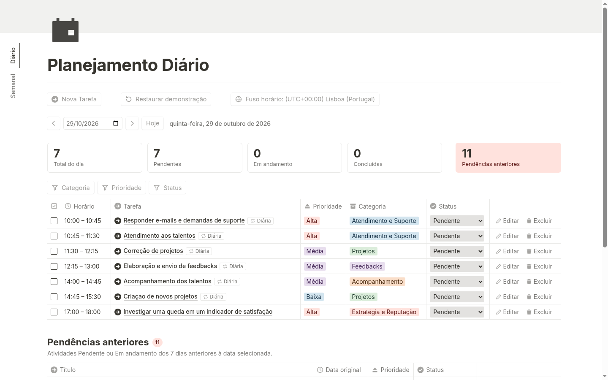
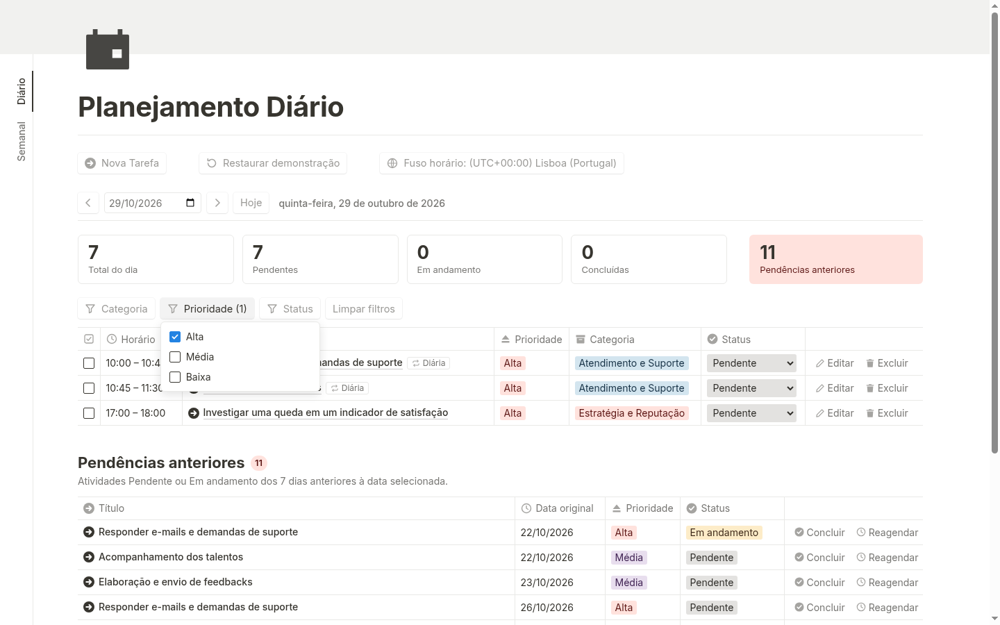
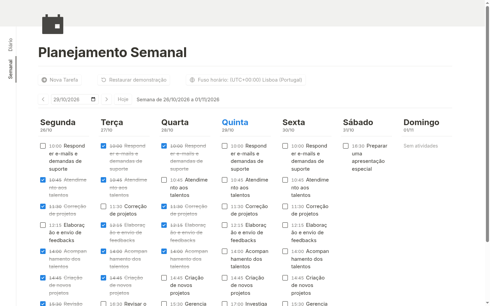
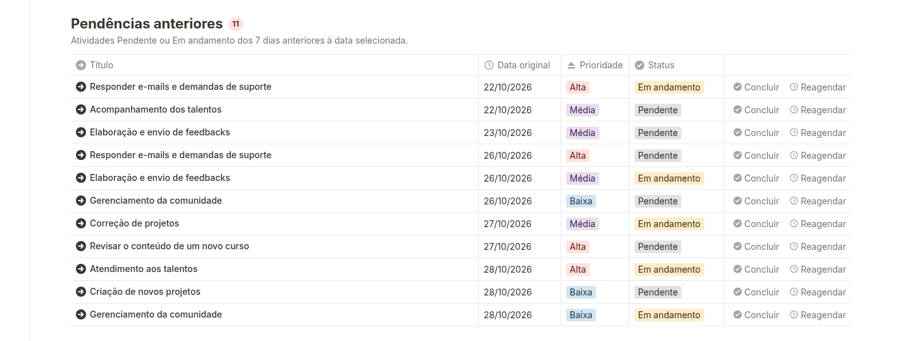
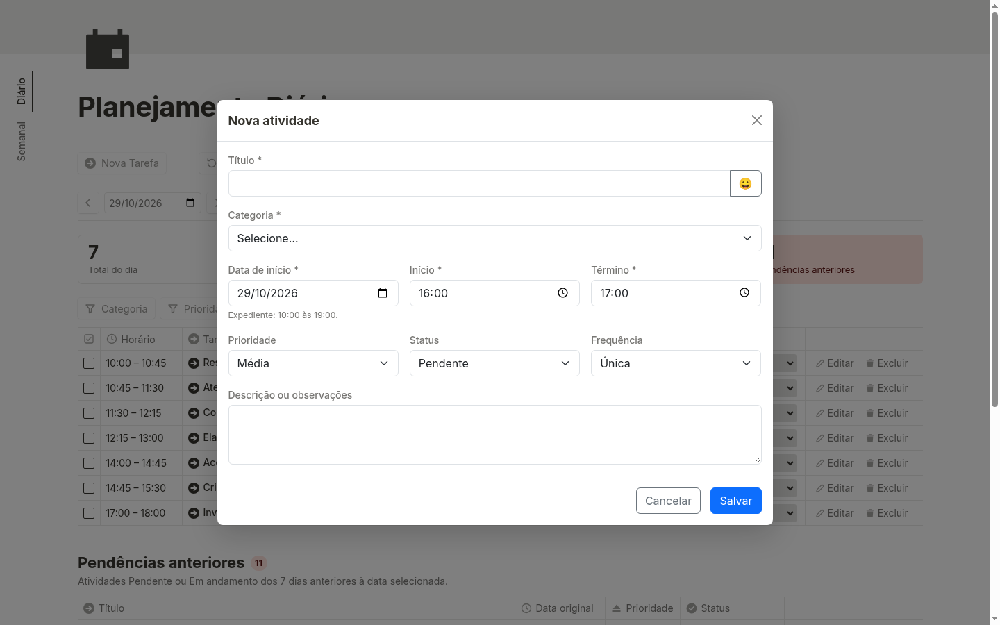

# Task Accelerator Manager


Agenda individual de tarefas e atendimentos, pensada para a rotina de profissionais de Education e Customer Success. Organiza o dia por horário, repete atividades automaticamente, acompanha o que ficou pendente nos dias anteriores e mostra um painel com o andamento do dia.

---

**Destaques**

- Agenda diária ordenada por horário e visão semanal de segunda a domingo.
- Atividades recorrentes: diárias, semanais, quinzenais e mensais, sem precisar cadastrar de novo.
- Status independente para cada ocorrência: concluir uma data não conclui as outras.
- Pendências dos últimos 7 dias, com conclusão e reagendamento.
- Painel do dia com totais por status.
- Filtros combináveis por categoria, prioridade e status.
- Fuso horário configurável.
- Roda inteiramente no navegador: sem login, sem servidor e sem banco de dados. Os dados ficam salvos no próprio navegador.
- Funciona no computador e no celular.

---

## Acesse online (sem instalar nada)

**➜ https://klebertteixeira.github.io/Task-Accelerator-Manager/**

Basta abrir o endereço no navegador, no computador ou no celular. Não é preciso instalar nada nem criar conta. Na primeira abertura, a agenda já vem com uma rotina de demonstração carregada, para que todas as funções possam ser vistas em uso.

---

## Sumário

- [Capturas de tela e vídeo](#capturas-de-tela-e-vídeo)
- [Guia de uso](#guia-de-uso)
- [Regras de funcionamento](#regras-de-funcionamento)
- [Como validar o funcionamento](#como-validar-o-funcionamento)
- [Executar localmente (opcional)](#executar-localmente-opcional)
- [Tecnologias e arquitetura](#tecnologias-e-arquitetura)
- [Dados de demonstração](#dados-de-demonstração)
- [Licença](#licença)

---

## Capturas de tela e vídeo

**▶ [Assistir ao vídeo de demonstração](capturas/video.mp4)**

**Agenda diária**



**Filtros**



**Recorrências na visão semanal**



**Pendências anteriores**



**Nova tarefa**



---

## Guia de uso

### Navegação

- **Diário** e **Semanal**: abas na lateral esquerda que alternam entre o planejamento do dia e o da semana.
- **‹** e **›**: vão para o dia anterior ou o próximo (na visão semanal, para a semana anterior ou a próxima).
- **Seletor de data**: escolhe qualquer data diretamente.
- **Hoje**: volta para a data atual.

### Cadastrar uma atividade

Clique em **Nova Tarefa** e preencha:

| Campo | Obrigatório | Valores |
|---|---|---|
| Título | Sim | Texto livre |
| Categoria | Sim | Lista fixa (ver [Categorias](#categorias)) |
| Data de início | Sim | Hoje ou uma data futura |
| Início e Término | Sim | Dentro do expediente, das 10:00 às 19:00 (horário de Portugal) |
| Prioridade | — | Alta, Média ou Baixa |
| Status | — | Pendente, Em andamento ou Concluída |
| Frequência | — | Única, Diária, Semanal, Quinzenal ou Mensal |
| Descrição ou observações | Não | Texto livre |

Ao clicar em **Salvar**, o sistema confere os dados. Se houver algum problema (campo obrigatório vazio, horário fora do expediente, término antes do início ou data no passado), a mensagem aparece no próprio formulário e nada é gravado.

### Agenda do dia

A tela **Planejamento Diário** lista as atividades da data selecionada, em ordem de horário, com as colunas:

- **Horário**: início e término.
- **Tarefa**: título e, quando a atividade se repete, uma etiqueta com a frequência.
- **Prioridade**, **Categoria** e **Status**.
- **Editar** e **Excluir**.

Para concluir uma atividade, marque a caixa no início da linha (desmarcar volta para Pendente). O status também pode ser trocado direto na lista, no seletor da coluna **Status**. Clicar no título abre a edição.

### Painel do dia

Acima da agenda ficam os indicadores da data selecionada, já contando as atividades recorrentes daquele dia:

- **Total do dia**, **Pendentes**, **Em andamento** e **Concluídas**.
- **Pendências anteriores**, exibido separado dos demais.

Os filtros não alteram o painel: ele sempre mostra o dia completo.

### Pendências anteriores

Abaixo da agenda, a lista **Pendências anteriores** reúne as atividades com status Pendente ou Em andamento dos 7 dias anteriores à data selecionada, mostrando **Título**, **Data original**, **Prioridade** e **Status**.

- **Concluir**: marca a pendência como concluída e ela sai da lista.
- **Reagendar**: abre o formulário com nova data e horário. Ao reagendar para hoje ou para uma data futura, a pendência sai da lista e passa a aparecer na nova data.

Cada ocorrência de uma atividade recorrente é acompanhada de forma individual: se o atendimento de segunda-feira não foi concluído, ele aparece como pendência na terça-feira, sem impedir o atendimento de terça.

### Filtros

Acima da agenda há filtros de **Categoria**, **Prioridade** e **Status**. Cada filtro aceita vários valores, e os três podem ser combinados. **Limpar filtros** remove todos de uma vez. Os filtros valem só para a agenda do dia: as pendências anteriores continuam sempre visíveis.

### Editar e excluir atividades recorrentes

Ao editar uma atividade que se repete, o sistema pergunta onde a alteração vale:

- **Só esta ocorrência**: muda apenas aquela data (título, descrição, categoria, prioridade, data e horário).
- **Série completa**: muda a série a partir da data de início informada no formulário. O que já passou fica como estava.

Ao excluir uma atividade que se repete, o sistema pergunta:

- **Só esta ocorrência**: remove apenas aquela data.
- **Série completa**: remove a série inteira.

Atividades de frequência Única pedem apenas a confirmação da exclusão.

### Visão semanal

A aba **Semanal** mostra a semana da data selecionada, de segunda a domingo, com as atividades de cada dia e seus horários. Nela é possível concluir atividades pela caixa de marcação e abrir a edição clicando no título. Clicar no nome do dia abre aquele dia na aba **Diário**.

### Fuso horário

O botão **Fuso horário** mostra o fuso em uso e permite escolher outro, com busca pelo nome, com ou sem acento (ex.: `Lisboa`, `São Paulo` ou `sao paulo`). Os fusos mais usados aparecem com o nome em português; os demais, com o nome internacional (ex.: `Asia/Tokyo`). O padrão é o horário de Lisboa. Todas as datas e horários passam a ser exibidos no fuso escolhido, e o expediente de Portugal é convertido automaticamente.

### Restaurar demonstração

O botão **Restaurar demonstração** apaga os dados atuais e carrega novamente a rotina de demonstração. Antes de apagar, o sistema pede confirmação.

### Dados salvos

Atividades, regras de recorrência, status de cada ocorrência e o fuso escolhido ficam gravados no navegador e continuam lá depois de recarregar ou fechar a página. Os dados pertencem àquele navegador e àquele aparelho: outro navegador ou outro aparelho começa com a demonstração.

---

## Regras de funcionamento

### Horários

- Expediente das **10:00 às 19:00, horário de Portugal**, todos os dias.
- O término deve ser maior que o início.
- Atividades com horários sobrepostos são permitidas.
- Não é possível cadastrar, editar ou reagendar uma atividade para data e hora no passado.

### Frequências

| Frequência | Quando aparece |
|---|---|
| Única | Só na data cadastrada |
| Diária | De segunda a sexta-feira |
| Semanal | No mesmo dia da semana da data de início, inclusive sábado e domingo |
| Quinzenal | A cada 14 dias a partir da data de início |
| Mensal | No mesmo dia do mês; os dias 29, 30 e 31 caem no último dia dos meses que não os têm |

As atividades recorrentes aparecem sozinhas nas datas certas. O sistema calcula as ocorrências pela regra, sem gravar uma cópia de cada data futura.

### Ocorrências

- Status, conclusão e reagendamento afetam só a data escolhida; as demais ocorrências da série não mudam.
- O reagendamento mantém o status e muda só a data e o horário.
- Em uma atividade recorrente, o status escolhido no formulário vale para a ocorrência da data de início; as seguintes começam como Pendente.
- A edição da **série completa** vale da data de início informada em diante. As ocorrências anteriores e as que foram alteradas individualmente não mudam. Se a ocorrência de hoje já começou, ela permanece como estava.

### Pendências anteriores

- Entram as ocorrências Pendente ou Em andamento dos 7 dias anteriores à data selecionada.
- Só contam dias que já passaram: ao selecionar uma data futura, os dias que ainda não chegaram ficam de fora.
- Uma ocorrência reagendada conta pela nova data: se essa data também passar sem conclusão, ela volta a ser pendência, mantendo a data original na lista.

### Categorias

Atendimento e Suporte, Projetos, Feedbacks, Acompanhamento, Comunidade, Customer Success, Análise de Dados, Estratégia e Reputação, Marketing, Treinamentos, Webinars, Mentorias, Planejamento e Outras.

---

## Como validar o funcionamento

Roteiro rápido para conferir as principais funções, a partir da demonstração:

1. **Agenda do dia**: abra o sistema e confira as atividades de hoje em ordem de horário, com as etiquetas de frequência nas recorrentes.
2. **Cadastro**: clique em **Nova Tarefa**, preencha os campos e salve. Tente também um horário fora do expediente ou no passado e veja a mensagem de erro.
3. **Edição e exclusão**: edite e exclua uma atividade única e uma recorrente, testando **Só esta ocorrência** e **Série completa**.
4. **Conclusão**: marque uma atividade recorrente como concluída e navegue para outro dia: as outras ocorrências continuam com o próprio status.
5. **Recorrências**: use **‹**, **›** e o seletor de data para conferir diárias (segunda a sexta), semanais, quinzenais e mensais nas datas certas.
6. **Filtros**: combine categoria, prioridade e status e veja a agenda mudar, enquanto o painel e as pendências continuam iguais.
7. **Pendências anteriores**: conclua uma pendência e reagende outra para hoje ou para depois: as duas saem da lista.
8. **Painel**: confira se os totais acompanham as mudanças de status.
9. **Dados salvos**: recarregue a página e veja que tudo continua como estava.
10. **Celular**: abra o mesmo endereço no celular ou reduza a janela do navegador.

---

## Executar localmente (opcional)

Esta parte é só para quem quiser rodar o código no próprio computador. Para usar o sistema, basta o [endereço online](#acesse-online-sem-instalar-nada).

### 1. Instalar o .NET 10

Baixe e instale o **SDK do .NET 10** em https://dotnet.microsoft.com/download/dotnet/10.0 (Windows, macOS ou Linux). Para conferir a instalação, abra um terminal e rode:

```bash
dotnet --version
```

O número exibido deve começar com `10`.

### 2. Obter o código

Em https://github.com/KleberTTeixeira/Task-Accelerator-Manager, clique em **Code → Download ZIP** e extraia o arquivo, ou use o Git:

```bash
git clone https://github.com/KleberTTeixeira/Task-Accelerator-Manager.git
cd Task-Accelerator-Manager
```

### 3. Executar

Na pasta raiz do projeto:

```bash
dotnet run --project src/TaskManager.Web
```

Abra **http://localhost:5154** no navegador. Para encerrar, pressione `Ctrl+C` no terminal.

### 4. Executar os testes automatizados

```bash
dotnet test TaskManager.sln
```

### Solução de problemas

- **`dotnet` não é reconhecido**: o SDK não foi instalado ou o terminal foi aberto antes da instalação. Instale o SDK e abra um novo terminal.
- **Porta 5154 em uso**: feche o programa que está usando a porta, ou o outro terminal que já está rodando o projeto, e execute de novo.
- **Dados diferentes do esperado**: os dados ficam no navegador. Use **Restaurar demonstração** para voltar ao estado inicial.

---

## Tecnologias e arquitetura

- **C#** com **Blazor WebAssembly** standalone (o aplicativo inteiro roda no navegador) e **.NET 10**.
- **Bootstrap** e CSS próprio para o visual responsivo.
- **Blazored.LocalStorage 4.5.0** para gravar os dados no `localStorage` do navegador.
- **xUnit** para os testes automatizados.

Datas e horários são gravados em UTC e exibidos no fuso configurado.

```
TaskManager.sln
├── src/
│   ├── TaskManager.Domain/   Regras de negócio: atividades, validações, recorrência,
│   │                          ocorrências, painel, pendências, filtros e fuso horário
│   └── TaskManager.Web/      Interface em Blazor WebAssembly e dados de demonstração
└── tests/
    └── TaskManager.Tests/    Testes automatizados das regras de negócio
```

---

## Dados de demonstração

A demonstração simula a rotina de uma profissional de Education e Customer Success (horários de Portugal). Ela é carregada automaticamente no primeiro acesso e pelo botão **Restaurar demonstração**.

### Diárias (segunda a sexta)

As diárias e as semanais começam cerca de duas semanas antes do primeiro acesso, para que já existam histórico e pendências anteriores. Parte das ocorrências passadas aparece como Concluída e parte como Pendente ou Em andamento.

| Horário | Atividade | Categoria | Prioridade |
|---|---|---|---|
| 10:00–10:45 | Responder e-mails e demandas de suporte | Atendimento e Suporte | Alta |
| 10:45–11:30 | Atendimento aos talentos | Atendimento e Suporte | Alta |
| 11:30–12:15 | Correção de projetos | Projetos | Média |
| 12:15–13:00 | Elaboração e envio de feedbacks | Feedbacks | Média |
| 14:00–14:45 | Acompanhamento dos talentos | Acompanhamento | Média |
| 14:45–15:30 | Criação de novos projetos | Projetos | Baixa |

O intervalo das 13:00 às 14:00 fica livre.

### Semanais

| Dia | Horário | Atividade | Categoria | Prioridade |
|---|---|---|---|---|
| Segunda-feira | 15:30–16:00 | Revisão de prioridades da semana | Planejamento | Alta |
| Segunda-feira | 16:00–16:30 | Gerenciamento da comunidade | Comunidade | Baixa |
| Quarta-feira | 15:30–16:00 | Gerenciamento da comunidade | Comunidade | Baixa |
| Sexta-feira | 15:30–16:00 | Gerenciamento da comunidade | Comunidade | Baixa |

### Quinzenais

| Início | Horário | Atividade | Categoria | Prioridade |
|---|---|---|---|---|
| 03/11/2026 | 16:00–17:00 | Análise de métricas de Customer Success | Customer Success | Alta |
| 05/11/2026 | 16:00–17:00 | Análise de dados operacionais | Análise de Dados | Média |
| 06/11/2026 | 16:00–17:00 | Análise de métricas de marketing | Marketing | Média |

### Mensais

| Início | Horário | Atividade | Categoria | Prioridade |
|---|---|---|---|---|
| 10/11/2026 | 16:00–17:00 | Planejamento de treinamentos e cursos | Treinamentos | Média |
| 12/11/2026 | 16:00–17:00 | Organização de webinars | Webinars | Baixa |
| 17/11/2026 | 16:00–17:00 | Organização da mentoria mensal | Mentorias | Média |
| 19/11/2026 | 17:00–18:00 | Realização da mentoria mensal | Mentorias | Alta |
| 24/11/2026 | 16:00–17:00 | Análise de reputação e satisfação dos clientes | Estratégia e Reputação | Alta |

### Pontuais (frequência Única)

Datas contadas a partir do primeiro acesso:

| Quando | Horário | Atividade | Categoria | Prioridade | Status |
|---|---|---|---|---|---|
| 4 dias antes | 17:00–18:00 | Atualizar materiais de treinamento | Treinamentos | Média | Concluída |
| 2 dias antes | 16:30–17:30 | Revisar o conteúdo de um novo curso | Treinamentos | Alta | Pendente |
| No dia | 17:00–18:00 | Investigar uma queda em um indicador de satisfação | Estratégia e Reputação | Alta | Pendente |
| 2 dias depois | 16:30–17:30 | Preparar uma apresentação especial | Outras | Média | Pendente |

Todos os dados são fictícios.

---

## Licença

**Task Accelerator Manager** — Copyright (c) 2026 Kleber T Teixeira.

Este trabalho está licenciado sob a [Creative Commons Atribuição-NãoComercial-CompartilhaIgual 4.0 Internacional (CC BY-NC-SA 4.0)](https://creativecommons.org/licenses/by-nc-sa/4.0/deed.pt-br). Em resumo:

- **Atribuição**: é preciso dar o crédito ao autor e indicar se houve alterações.
- **Não comercial**: não é permitido o uso para fins comerciais.
- **Compartilha igual**: versões modificadas devem ser distribuídas sob a mesma licença.

O texto completo está no arquivo [`LICENSE`](LICENSE).
